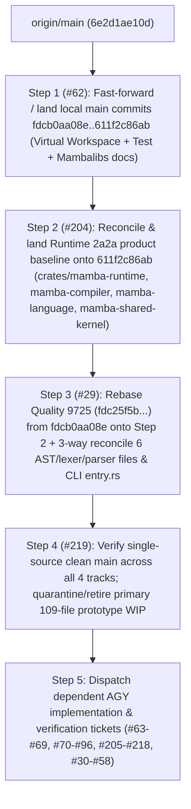

# AGY Source Baseline Audit: Test, Native Libs, Runtime, and Quality

- **Audit Ticket:** `#61` (`source: map the Test, Runtime and Quality baselines before AGY handoff`)
- **Parent Release Coordination Ticket:** `#27` (`release: 0.1.0-alpha native Test, Libs, Quality and Runtime readiness`)
- **Downstream Reconciliation Gate:** `#219` (`source: reconcile single-source main before release verification`)
- **Audit Worktree Base (`origin/main`):** `6e2d1ae10dffd45d5c9244f3ad259e7bc4cc99ce` (`chore: bootstrap standalone mamba repository`)
- **Audit Scope:** `docs/operations/agy/source-baselines.md` only (zero product, workspace, test, or workflow changes)

> [!IMPORTANT]
> **Governance & Non-Authorization Boundary**
>
> This document is a read-only source-topology audit for `#61` under `#27`. It:
> 1. **Does not choose a release version** between the GitHub milestone title (`0.1.0-alpha`) and `Cargo.toml` (`0.4.13`).
> 2. **Does not accept any track** (`#5`, `#6`, `#7`, `#15`–`#25`, `#26`, or `#27`) or waive any parent acceptance criterion.
> 3. **Does not authorize** merging unpushed commits, copying or staging files across checkouts, committing or pushing protected dirty worktrees, or publishing any release tag, binary, installer, or wheel.
> 4. **Leaves unknown or uncaptured evidence explicitly marked `unknown`** rather than inferred.

---

## 1. Source Refs, Commit Graph, and Dirty-Manifest Identities

All isolated AGY issue worktrees created by `issue.sh` branch from `origin/main` (`6e2d1ae10dffd45d5c9244f3ad259e7bc4cc99ce`). Meanwhile, the local repository contains five unpushed commits on local `main` plus three distinct dirty worktree states (Primary checkout protected WIP, Runtime `2a2a`, and Quality `9725`).

### 1.1 Local Commit Graph (`origin/main..main`)

| Order | Commit SHA | Branch / Ref Labels | Commit Subject | Summary of Committed Delta |
| :--- | :--- | :--- | :--- | :--- |
| 0 (Remote Base) | `6e2d1ae10dffd45d5c9244f3ad259e7bc4cc99ce` | `origin/main`, `origin/HEAD`, `agy/issue-61` base | `chore: bootstrap standalone mamba repository` | Single root package (`[package] name = "mamba"`, `version = "0.4.13"`, `src/main.rs`) + mixed workspace (`mambalibs/*` and 9 `crates/*` members). |
| 1 | `fdcb0aa08ec0778ce63ec75d8b0b66f71083834a` | Detached `HEAD` of Quality worktree `9725` | `refactor: standardize Rust workspace and call lowering modules` | Converts root `Cargo.toml` into a virtual workspace; moves kits under `crates/*`; extracts `crates/mamba-shared-kernel`, `crates/mamba-language`, `crates/mamba-runtime`, `crates/mamba-test-support`, `crates/mamba-compiler`, `crates/mamba-pkg`, `crates/mamba-cli`; adds `ddd.toml` and `[workspace.lints.clippy] mod_module_files = "deny"`. |
| 2a | `6881195835c85ba7ac9d52f578f4009ad8d8ee1c` | First parent of `ee950f2f35` | `feat(test): extract Rust runner and add native test library` | Adds `crates/mamba-test` and `crates/mambalibs-unittest`; wires `mamba test <path>` (`--engine mamba` default) and `mamba pytest <path>` (`--engine python` default) in `crates/mamba-cli`. |
| 2b | `e20cf033db6d11ea167f3a741c8f29f56c16a860` | `codex/mambalibs-backlog` (second parent of `ee950f2f35`) | `docs(mambalibs): record follow-up issues and current test commands (#7)` | Updates `STATUS.md`, `docs/product/mambalibs.md`, and `mambalibs/README.md` with `#8`–`#14` backlog links and `crates/mamba-cli --test it` selectors. |
| 3 | `ee950f2f359434be6e080db21d6e82b52a891296` | Merge commit | `merge: retain current mambalibs plan in Test delivery` | Merges `6881195835c85ba7ac9d52f578f4009ad8d8ee1c` and `e20cf033db6d11ea167f3a741c8f29f56c16a860` onto `fdcb0aa08ec0778ce63ec75d8b0b66f71083834a`. |
| 4 (Local `main`) | `611f2c86abe4ec27d8a74c9eda7473eeb8c6519a` | `main`, `codex/native-test-runner-library`, detached `HEAD` of Runtime `2a2a` | `docs(test): record main landing and follow-up issues` | Records `docs/migrations/test-tool/landing/` receipts (`primary-preservation.json`, `validation.json`, `files.json` covering 235 task paths). |

### 1.2 Track & Worktree Identity Matrix

| Source / Track | Checkout Path | Git Base Ref & SHA | Dirty / Snapshot Manifest Identity | Track Scope & Status |
| :--- | :--- | :--- | :--- | :--- |
| **Remote `origin/main` (AGY Worktree Base)** | `/Users/chrischeng/faberlines/mamba/.agents/worktrees/issue-*` | `origin/main` = `6e2d1ae10dffd45d5c9244f3ad259e7bc4cc99ce` | Clean (`0` dirty or untracked paths at checkout creation) | Only committed baseline currently visible on GitHub `origin/main`. Lacks virtual workspace split, `crates/mamba-cli`, `crates/mamba-test`, `crates/mambalibs-unittest`, `crates/mamba-quality`, and `2a2a` runtime WIP. |
| **Test & Mambalibs Track (`#5`, `#6`, `#7`, `#8`–`#14`)** | Committed on local `main` (`/Users/chrischeng/faberlines/mamba`) | `main` = `611f2c86abe4ec27d8a74c9eda7473eeb8c6519a` (integrating `6881195835c85ba7ac9d52f578f4009ad8d8ee1c` + `e20cf033db6d11ea167f3a741c8f29f56c16a860`) | **Committed Test delivery:** 235 task paths (`docs/migrations/test-tool/landing/evidence/files.json`); `#5` patch SHA-256 `e0b9da61ff503a5f5186c14770194953aca51303108156470671a163c9b94c7d`; tested binary SHA-256 `38f792043540f04662e37c5ca05cf95242c75d0e71b74fb6d4470034fc693311`.<br>**Primary checkout dirty WIP (non-Test protected WIP):** `109` paths (`26` tracked modifications + `83` untracked paths; `protected_diff_before_sha256` = `dfc67b56b5578a93c980612f756f196172c3578c45604b352a938152963f8018`, `protected_diff_after_sha256` = `816b4d6e8fc19b5118679580a46db9302648bec84f1d6227077d86ed74687566`, empty index). | Test runner (`crates/mamba-test`), native unittest (`crates/mambalibs-unittest`), and Mambalibs doc alignment (`#7`) are committed on local `main` (`ahead 5` of `origin/main`), but unpushed. The 109 dirty files in `/Users/chrischeng/faberlines/mamba` belong to an earlier original-Python quality host (`mamba quality <project> --python ... --engine cpython\|mamba-jit`) and `librt_internal_mod` WIP, **not** the Test track. |
| **Runtime Track (`#26`, `#204`–`#218`)** | `/Users/chrischeng/.codex/worktrees/2a2a/mamba` (peers: `327c/mamba`, `4e1a/mamba`) | Detached `HEAD` = `611f2c86abe4ec27d8a74c9eda7473eeb8c6519a` | **Protected WIP snapshot:** `74,903` dirty status entries (`96` tracked modified/deleted paths + `74,807` untracked paths, empty index).<br>**Recorded `#26` overlay manifests:**<br>- `annotation-source-provenance-coherent-v1-installed/manifest.json`: SHA-256 `c5a69857978a1e202e44905518d23b1a3b64e4cad95c17ac6f5950a6eaa93b7c`<br>- `traceframe-panic-QA-v3-installed/manifest.json`: SHA-256 `51e88d63d28c5a81401d8b16921aa33a55a38cabc71d14d63011b76736a6f75a`<br>- `batch45-trace-AP03-firstslot-finite-gate-acceptance-v1.json`: SHA-256 `15a94585659b6a3ffe031b024d96375f0a46f30099bff1b53117daff6d14a9d0` | Built on top of local `main` (`611f2c86a`), adding native runtime, compiler, language, shared-kernel, and stdlib parity work for `mamba run --compile <app.py>`, plus `tests/conformance/cpython_3_11/` corpus (`74,807` untracked paths). Uncommitted and unpushed. |
| **Native Quality Track (`#15`–`#25`, `#29`–`#58`)** | `/Users/chrischeng/.codex/worktrees/9725/mamba` (workers: `quality-luna/mamba`, `quality-sol/mamba`, `quality-pylint-star/mamba`, `quality15-catalog/mamba`, `quality15-decorators/mamba`) | Detached `HEAD` = `fdcb0aa08ec0778ce63ec75d8b0b66f71083834a` | **Current pause handoff manifest (`#15`, `#21`, 2026-10-21):** SHA-256 `fdc25f5b7fb135cbfcb15f5e24219db6b9e4e6c73b964b612e7668e5855c82f6` across `78,845` files (`45` tracked modifications + `1,978` untracked dirty entries in `git status`, empty index).<br>**Superseded historical manifests:**<br>- `7ed342bd239834c3cd07e2636e3257e6cd4850584299b42202196270e70c2a2c` (`78,810` paths)<br>- `e3656b2d0653fe9733464f821bfe58c93d4ed45f2292945001e89df4a7afca94` (`4,204` Quality files; full source `c81a7e198de3d86a67169e30c7956fa3191932ac49244aafcde42e42fe42a61b`)<br>**Local handoff metadata:** `/private/tmp/mamba-quality-paused-gh-todos-main-20261021-1/HANDOFF.md` and `/private/tmp/mamba-quality-current-state-main-20261021-1.json` (local disk only; not uploaded to GitHub). | Built on `fdcb0aa08e` (before `6881195835`..`611f2c86a`). Contains `crates/mamba-quality`, `crates/mamba-black-layout` (`vendor/mamba-black-layout`), `crates/mamba-document-layout` (`vendor/mamba-document-layout`), `tools/python_quality/**`, and five-tool native `mamba quality` CLI (`check`, `fix`, `format`, `info`, default all-five). Uncommitted and unpushed. |

---

## 2. Package Paths and Public Commands by Source

### 2.1 Package & Crate Path Matrix

| Package / Crate / Path | `origin/main` (`6e2d1ae10d`) | Intermediate Workspace (`fdcb0aa08e`) | Local `main` (`611f2c86ab`, clean) | Primary Checkout Dirty WIP (`611f2c86ab` + 109 dirty) | Runtime `2a2a` (`611f2c86ab` + 74,903 dirty) | Quality `9725` (`fdcb0aa08e` + `fdc25f5b...`) |
| :--- | :--- | :--- | :--- | :--- | :--- | :--- |
| Root `Cargo.toml` mode | Root `[package] name = "mamba"` (`0.4.13`) + `[workspace]` | Virtual `[workspace]` (`version = "0.4.13"`) | Virtual `[workspace]` (`version = "0.4.13"`) | Virtual `[workspace]` (`version = "0.4.13"`) | Virtual `[workspace]` (`version = "0.4.13"`) | Virtual `[workspace]` (`version = "0.4.13"`) |
| `src/main.rs` & `src/cli/**` (root binary package) | Present | Absent (moved to `crates/mamba-cli`) | Absent | Absent | Absent | Absent |
| `ddd.toml` | Absent | Present | Present | Present (modified in dirty WIP) | Present | Present (modified in dirty WIP) |
| `mambalibs/*` Cargo members (`mambalibs/httpkit`, `mambalibs/dikit`, `mambalibs/pgkit/*`, `mambalibs/mongokit/*`, `mambalibs/agentkit/*`, `mambalibs/arraykit/*`, `mambalibs/scikit/*`, `mambalibs/plotkit/*`, `mambalibs/mediakit/*`, `mambalibs/cryptokit/*`, `mambalibs/queuekit`) | Present as workspace members under `mambalibs/*` | Moved to `crates/*` (`mambalibs/` holds `README.md` + `wheel_test_support.rs`) | Moved to `crates/*` (`mambalibs/` holds `README.md` + `wheel_test_support.rs`) | Same as local `main` | Same as local `main` | Moved to `crates/*` (`mambalibs/` holds older `README.md` + `wheel_test_support.rs`) |
| `crates/mamba-registry`, `crates/schema-mamba`, `crates/log-mamba`, `crates/qc-mamba`, `crates/mcp-mamba`, `crates/schema`, `crates/frame` | Present | Present | Present | Present | Present | Present |
| `crates/core` / `crates/log` vs `crates/mamba-core` / `crates/mamba-log` | `crates/core`, `crates/log` | Renamed to `crates/mamba-core`, `crates/mamba-log` | `crates/mamba-core`, `crates/mamba-log` | `crates/mamba-core`, `crates/mamba-log` | `crates/mamba-core`, `crates/mamba-log` | `crates/mamba-core`, `crates/mamba-log` |
| `crates/mamba-cli`, `crates/mamba-compiler`, `crates/mamba-runtime`, `crates/mamba-language`, `crates/mamba-shared-kernel`, `crates/mamba-pkg`, `crates/mamba-test-support` | Absent | Present | Present | Present (dirty edits in `mamba-cli`, `mamba-compiler`, `mamba-runtime`, `mamba-language`, `mamba-shared-kernel`, `mamba-test-support`) | Present (extensive dirty WIP across compiler, runtime, language, shared-kernel, cli) | Present (dirty edits in `mamba-cli`, `mamba-compiler`, `mamba-runtime`, `mamba-language`, `mamba-shared-kernel`) |
| `crates/mamba-test` | Absent | Absent | Present (`mamba-test`) | Present | Present | Absent |
| `crates/mambalibs-unittest` | Absent | Absent | Present (`mambalibs-unittest`, exports `mambalibs.unittest.raises`) | Present | Present | Absent |
| `crates/mamba-quality` | Absent | Absent | Absent | Absent (uses inline `crates/mamba-cli/src/cli/handlers/quality/` + `src/quality/`) | Absent | Present (`crates/mamba-quality`) |
| `crates/mamba-black-layout`, `crates/mamba-document-layout` (`vendor/mamba-black-layout`, `vendor/mamba-document-layout`) | Absent | Absent | Absent | Absent | Absent | Present |
| `tools/python_quality/**` & `docs/operations/python-quality/**` | Absent | Absent | Absent | Partial (`tools/python_quality/collect_real_project_baseline.py` in dirty WIP) | Absent | Present (`tools/python_quality/**`, `docs/operations/python-quality/**`) |

### 2.2 Public CLI Command & API Surface Matrix

| Public Command / Surface | `origin/main` (`6e2d1ae10d`) | Intermediate Workspace (`fdcb0aa08e`) | Local `main` (`611f2c86ab`, clean) | Primary Checkout Dirty WIP (`611f2c86ab` + 109 dirty) | Runtime `2a2a` (`611f2c86ab` + 74,903 dirty) | Quality `9725` (`fdcb0aa08e` + `fdc25f5b...`) |
| :--- | :--- | :--- | :--- | :--- | :--- | :--- |
| `mamba run [FILE] [--compile] [-- args...]` | Legacy `src/main.rs` (`--compile`, `--opt-level`, `--emit-mir`, `--emit-llvm`) | Extracted to `crates/mamba-cli` (`--compile`, `--opt-level`, `--emit-mir`, `--emit-llvm`) | Extracted to `crates/mamba-cli` | Extracted to `crates/mamba-cli` | Extracted to `crates/mamba-cli` + `#26` native compiler/runtime parity WIP | Extracted to `crates/mamba-cli` (at `fdcb0aa08e` runtime baseline + parser/lexer additions) |
| `mamba test [PATH]` | Legacy `Test { path, filter, conformance, category, regen_golden, verbose }` — **no `--engine` flag**, no `crates/mamba-test` | Same legacy flags in `crates/mamba-cli/src/entry.rs` — **no `--engine` flag** | `mamba test <path>` routed through `crates/mamba-test` (`--engine mamba` default, `--engine mamba\|python`, `--list`, `-k/--filter`, `--conformance`) | Same as local `main` (`crates/mamba-test`) | Same as local `main` (`crates/mamba-test`) | Legacy `fdcb0aa08e` `mamba test` (**no `--engine` flag**, no `crates/mamba-test`) |
| `mamba pytest [PATH]` | Legacy `Pytest { path, filter, verbose }` — **no `--engine` flag** | Legacy `Pytest { path, filter, verbose }` — **no `--engine` flag** | `mamba pytest <path>` routed through `crates/mamba-test` (`--engine python` default, `--engine mamba\|python`, `--list`, `-k/--filter`, `[pytest_args...]`) | Same as local `main` (`crates/mamba-test`) | Same as local `main` (`crates/mamba-test`) | Legacy `fdcb0aa08e` `mamba pytest` (**no `--engine` flag**, no `crates/mamba-test`) |
| `mambalibs.unittest.raises` | Absent | Absent | Present (`crates/mambalibs-unittest`) | Present | Present | Absent |
| `mamba quality ...` | Absent | Absent | Absent | Incompatible prototype: `mamba quality <project> --python <path> --engine cpython\|mamba-jit --evidence <dir>` | Absent | Native 5-tool surface: `mamba quality [PATH...]`, `mamba quality check [PATH...] [--json]`, `mamba quality fix [PATH...] [--diff] [--json]`, `mamba quality format [PATH...] [--check \| --diff] [--json]`, `mamba quality info [PATH...] [--json]` + Rust `mamba_quality::{run_quality, QualityRequest, QualityOperation, QualityReport}` (`mamba.quality.v2`) |
| Other CLI subcommands (`build`, `check`, `bench`, `test-batch`, `surface-report`, `llm`, `upgrade`, `report-issue`, `init`, `migrate`, `auth`, `add`, `remove`, `lock`, `audit`, `export`, `tree`, `version`, `package`, `publish`, `pip`, `venv`, `python`, `shell`, `workspace`, `index`, `sync`, `validate`, `install`, `tool`, `hash`, `cache`, `generate-shell-completion`) | Present in `src/main.rs` | Present in `crates/mamba-cli/src/entry.rs` | Present in `crates/mamba-cli/src/entry.rs` | Present in `crates/mamba-cli/src/entry.rs` | Present in `crates/mamba-cli/src/entry.rs` | Present in `crates/mamba-cli/src/entry.rs` |

---

## 3. Missing Source Prerequisites per Track Before AGY Queue Dispatch

Because the AGY worker loop (`issue.sh claim`) creates every issue branch from `origin/main` (`6e2d1ae10dffd45d5c9244f3ad259e7bc4cc99ce`), any ticket whose file paths, crate names, or baseline implementations exist only on `fdcb0aa08ec0778ce63ec75d8b0b66f71083834a`, `611f2c86abe4ec27d8a74c9eda7473eeb8c6519a`, `2a2a`, or `9725` cannot be implemented or verified on `origin/main` until its prerequisite baseline lands on `origin/main`.

### 3.1 Test Track (`#5`, `#6`, `#62`–`#69`)

- **Affected Tickets:**
  - Parent `#5` (`test: native Rust test runner and mamba test/pytest CLI contract`) and children `#62` (land Test & Mambalibs commits to `origin/main`), `#63` (compiler-backed native test runner), `#64` (nested test discovery & `test_*.py` / `*_test.py` parity), `#65` (unify `mamba test` / `mamba pytest` under `--engine`), `#66` (`--list` read-only contract).
  - Parent `#6` (`unittest: native mambalibs.unittest assertion and raises library`) and children `#67` (`raises(..., match=...)`), `#68` (tuple of exception types in `raises(...)`), `#69` (`ExceptionInfo` return value from `with raises(...) as exc_info`).
- **Missing Prerequisites on `origin/main` (`6e2d1ae10d`):**
  1. Commit `fdcb0aa08ec0778ce63ec75d8b0b66f71083834a` (`crates/mamba-cli`, `crates/mamba-compiler`, `crates/mamba-runtime`, `crates/mamba-language`, `crates/mamba-shared-kernel`, `crates/mamba-test-support`, `ddd.toml`).
  2. Commit `6881195835c85ba7ac9d52f578f4009ad8d8ee1c` (`crates/mamba-test`, `crates/mambalibs-unittest`, and `crates/mamba-cli` `--engine` routing).
  3. Commit `e20cf033db6d11ea167f3a741c8f29f56c16a860`, merge `ee950f2f359434be6e080db21d6e82b52a891296`, and landing receipt commit `611f2c86abe4ec27d8a74c9eda7473eeb8c6519a` (tracked by `#62`).
  4. For `#63`, `#67`, `#68`, and `#69`: reconciliation with the Runtime track (`2a2a`) if native `with raises(...) as exc_info:` or direct compiler-backed execution requires updated `crates/mamba-compiler` / `crates/mamba-runtime` lowering beyond `611f2c86abe4ec27d8a74c9eda7473eeb8c6519a`.

### 3.2 Native Libs Track (`#7`, `#8`–`#14`, `#59`, `#60`, `#70`–`#96`)

- **Tickets Independent of Unpushed Commits (Already Dispatchable on `6e2d1ae10d`):**
  - `#59` (`crates/log-mamba` dual-module registration `mambalibs.log` + `mambalibs.logging`) and `#60` (`crates/qc-mamba` `run_qc` return contract) target crates that already exist at `crates/log-mamba` and `crates/qc-mamba` on `origin/main` (`6e2d1ae10d`).
- **Tickets Blocked on Missing Source Prerequisites:**
  - `#8` / `#70`–`#72` (`httpkit` / `crates/mambalibs-http`, `crates/mambalibs-http-binding`), `#9` / `#73`–`#76` (`dikit` / `crates/mambalibs-di`, `crates/mambalibs-di-binding`), `#10` / `#77`–`#80` (`pgkit` / `crates/pg`, `crates/pgkit-binding`), `#11` (`log-mamba` wheel harness parity), `#12` / `#81`–`#84` (`mongokit` / `crates/mongokit`, `crates/mongokit-binding`), `#13` / `#85`–`#89` (`agentkit` / `crates/agent`, `crates/agentkit-*`), `#14` / `#90`–`#95` (`qc-mamba` / `mcp-mamba` wheel harness parity), and `#96` (docs & release gate sync).
- **Missing Prerequisites on `origin/main` (`6e2d1ae10d`):**
  1. **Workspace Path Standardization (`fdcb0aa08ec0778ce63ec75d8b0b66f71083834a`..`611f2c86abe4ec27d8a74c9eda7473eeb8c6519a`):** On `origin/main`, the kits live at `mambalibs/httpkit`, `mambalibs/dikit`, `mambalibs/pgkit/*`, `mambalibs/mongokit/*`, `mambalibs/agentkit/*`, and wheel integration tests live under root `--test it`; on local `main` (`611f2c86ab`), they were moved and renamed to `crates/mambalibs-http*`, `crates/mambalibs-di*`, `crates/pg*`, `crates/mongokit*`, `crates/agent*`, with wheel tests under `crates/mamba-cli/tests/it/mambalibs_*_wheel.rs` (`cargo test -p mamba-cli --test it mambalibs_<kit>_wheel::`). Landing `#62` (`611f2c86ab`) first avoids path/package rename conflicts across all kit tickets.
  2. **Frozen Wheel Surface Contract (`#8`, `#9`, `#10`, `#12`, `#13`):** The exact public Python wheel symbols, class/function signatures, and error mappings for `http`, `di`, `pg`, `mongo`, and `agent` are still unauthored (`0` functions registered in `mambalibs/httpkit/binding/src/lib.rs` and `mambalibs/dikit/binding/src/lib.rs`, and no PyO3 `pymodule` in `pg`, `mongo`, or `agent`).
  3. **Native Runtime Value-Contract Prerequisite (`#10`, `#12`, `#13`, `#14`):** Moving `pg` (`query`/`query_one`), `mongo` (`insert_one`/`find_one`/`find`/`update_one`/`delete_one`), `agent` (`execute`/`chat`), and `mcp` (`call_tool`/`read_resource`) from scalar `i64` handles/counts to structured dicts/records/lists requires the structured value ABI in `crates/mamba-registry` and `crates/mamba-runtime` (`2a2a`).

### 3.3 Runtime Track (`#26`, `#204`–`#218`)

- **Affected Tickets:**
  - Parent `#26` (`runtime: native compiler and runtime parity for real Python apps`) and children `#204` (`#204` Runtime baseline reconciliation from `2a2a`), `#205`–`#218` (generator frame isolation, class body dynamic scopes, inheritance/MRO/metaclass, descriptor/dunder protocols, exception chaining/traceback, comprehension/cell capture, star-unpacking/kwarg evaluation, pattern matching, `asyncio`/awaitable scheduler, stdlib Tier-1 runtime modules, dynamic import/package resolution, GC/refcount cycle safety, native diagnostic traceback formatting, and real-app benchmark/parity gate).
- **Missing Prerequisites on `origin/main` (`6e2d1ae10d`):**
  1. Local `main` commit chain `fdcb0aa08ec0778ce63ec75d8b0b66f71083834a`..`611f2c86abe4ec27d8a74c9eda7473eeb8c6519a` (specifically `crates/mamba-runtime`, `crates/mamba-compiler`, `crates/mamba-language`, `crates/mamba-shared-kernel`, `crates/mamba-cli`, `crates/mamba-test`).
  2. Controlled extraction and commit of the `2a2a` Runtime/Compiler/Language/Shared-Kernel source baseline (tracked by `#204`), separating product source changes (`96` tracked modified/deleted paths + new runtime/compiler modules) from local-only scratch/benchmark artifacts and the `74,807`-file `tests/conformance/cpython_3_11/` untracked corpus.

### 3.4 Quality Track (`#15`–`#25`, `#29`–`#58`)

- **Affected Tickets:**
  - Parents `#15` (governance/manifest), `#16` (external dependency removal), `#17` (lint parity), `#18` (Black formatter parity), `#19` (Mypy parity), `#20` (Pyright parity), `#21` (corpus & mutation stability), `#22` (daemon/cache/incremental), `#23` (architecture & file-size guardrails), `#24` (docs & CLI help), `#25` (cross-platform CI & release artifacts), and children `#29`–`#58`.
- **Missing Prerequisites on `origin/main` (`6e2d1ae10d`):**
  1. Commit `fdcb0aa08ec0778ce63ec75d8b0b66f71083834a` (the detached `HEAD` base of `/Users/chrischeng/.codex/worktrees/9725/mamba`).
  2. Rebase/forward-port of the `9725` Quality source tree (`fdc25f5b7fb135cbfcb15f5e24219db6b9e4e6c73b964b612e7668e5855c82f6`) from `fdcb0aa08ec0778ce63ec75d8b0b66f71083834a` onto `611f2c86abe4ec27d8a74c9eda7473eeb8c6519a` (plus reconciled shared AST/lexer/CLI seams with Runtime `2a2a`), landing `crates/mamba-quality`, `crates/mamba-black-layout` (`vendor/mamba-black-layout`), `crates/mamba-document-layout` (`vendor/mamba-document-layout`), `tools/python_quality/**`, and `docs/operations/python-quality/**` (tracked by `#29`).
  3. Quarantining and retiring the incompatible 109-file prototype quality WIP in `/Users/chrischeng/faberlines/mamba` (`mamba quality <project> --python ... --engine cpython|mamba-jit`) so it never overwrites the native five-tool `mamba quality` contract from `9725`.

---

## 4. Shared-File Ownership and Integration Order

Multiple tracks modify the same workspace, CLI, language, and documentation files. To prevent silent clobbering, each shared path has a designated single-writer owner during baseline reconciliation (`#62` -> `#204` -> `#29` -> `#219`).

### 4.1 Shared-File Ownership Matrix

| Shared Path / Seam | Tracks Touching Path | Designated Single-Writer / Reconciliation Owner | Required Reconciliation Rule |
| :--- | :--- | :--- | :--- |
| `Cargo.toml`, `Cargo.lock` | `fdcb0aa08e`, Test (`6881195835`), Quality (`9725`) | **Workspace / Release Integrator (`#62` -> `#29` -> `#219`)** | Start from `611f2c86ab` virtual workspace (`crates/mamba-test`, `crates/mambalibs-unittest`), then add `crates/mamba-quality`, `crates/mamba-black-layout` (`vendor/mamba-black-layout`), and `crates/mamba-document-layout` (`vendor/mamba-document-layout`) in `#29`. Do not revert `[workspace.lints.clippy] mod_module_files = "deny"`. |
| `ddd.toml` | `fdcb0aa08e`, Test (`6881195835`), Primary dirty WIP, Quality (`9725`) | **Workspace / Quality Integrator (`#62` -> `#29` -> `#219`)** | Retain `mamba-test` and `mambalibs-unittest` layer declarations from `6881195835` and append `mamba-quality` / layout crate rules from `9725`. Ignore the unaccepted primary-checkout dirty `ddd.toml` edits unless explicitly ported. |
| `crates/mamba-cli/src/entry.rs`, `crates/mamba-cli/src/cli/commands/mod.rs`, `crates/mamba-cli/src/cli/handlers/mod.rs` | Test (`6881195835`), Primary dirty WIP, Runtime (`2a2a`), Quality (`9725`) | **CLI Surface Integrator (`#62` -> `#204` -> `#29` -> `#219`)** | Preserve `mamba test` / `mamba pytest` (`--engine mamba\|python`) from `6881195835`, `mamba run --compile` wiring from `2a2a`, and the 5-tool `mamba quality` subcommands (`check`, `fix`, `format`, `info`) from `9725`. Do **not** merge the primary checkout's `--engine cpython\|mamba-jit` quality CLI prototype. |
| `crates/mamba-cli/tests/it/main.rs` & `crates/mamba-cli/tests/it/**` | Test (`6881195835`), Primary dirty WIP, Quality (`9725`) | **CLI Integration Test Owner (`#62` -> `#29`)** | Additive module registration only: keep `test_cli` and `mambalibs_*_wheel` from `611f2c86ab` and add `quality_cli` from `9725`. |
| `crates/mamba-shared-kernel/src/ast/expr.rs`, `crates/mamba-shared-kernel/src/ast/stmt.rs` | Runtime (`2a2a`), Quality (`9725`) | **Language & AST Owner (`#204` -> `#29` 3-way merge)** | Identified in `#26` boundary audit as 2 of the **6 shared files requiring three-way reconciliation** between `2a2a` and `9725`. Merge AST variants additively so both compiler lowering (`2a2a`) and static analysis/formatting (`9725`) compile without semantic drift. |
| `crates/mamba-language/src/lexer/token.rs`, `crates/mamba-language/src/parser/expr_parser.rs`, `crates/mamba-language/src/parser/stmt_parser.rs`, `crates/mamba-language/src/parser/pattern.rs` | Runtime (`2a2a`), Quality (`9725`), Primary dirty WIP | **Language & Parser Owner (`#204` -> `#29` 3-way merge)** | Identified in `#26` boundary audit as the remaining **4 of 6 shared files requiring three-way reconciliation** (`token.rs`, `expr_parser.rs`, `stmt_parser.rs`, `pattern.rs`). Must satisfy both `2a2a` CPython 3.11 syntax/pattern semantics and `9725` lossless quality diagnostics/formatting. |
| `crates/mamba-compiler/**`, `crates/mamba-runtime/**` | Runtime (`2a2a`), Quality (`9725` minor AST consumer adjustments), Primary dirty WIP (`librt_internal_mod`) | **Runtime Track Owner (`#26` / `#204`)** | `2a2a` is authoritative for `crates/mamba-compiler/**` and `crates/mamba-runtime/**`. Any exhaustive match arms required by `9725` AST additions must be applied on top of `2a2a` in `#29`/`#219`. |
| `STATUS.md`, `docs/product/mambalibs.md`, `mambalibs/README.md` | Mambalibs (`e20cf033db` / `#7`), Quality (`9725` touches `STATUS.md` in historical snapshots) | **Documentation & Mambalibs Owner (`#62` -> `#96` -> `#219`)** | Keep `e20cf033db6d11ea167f3a741c8f29f56c16a860` (`#7`) authoritative for `mambalibs` status and commands until `#96` updates completed kit rows. |
| `.github/workflows/mamba-release.yml`, `scripts/install.sh`, `scripts/install.ps1` | Release (`#27`), Quality CI (`#25` / `#55`–`#58`), Docs (`#223`) | **Release & CI Workflow Owner (`#27` / `#219` / `#25`)** | Modify only after single-source reconciliation (`#219`) and explicit release-version governance decision (`#220`). |

### 4.2 Ordered Integration Sequence (Feeding `#219`)



1. **Step 1 — Land Committed Local `main` (`#62`):** Advance `origin/main` from `6e2d1ae10dffd45d5c9244f3ad259e7bc4cc99ce` through `fdcb0aa08ec0778ce63ec75d8b0b66f71083834a`..`611f2c86abe4ec27d8a74c9eda7473eeb8c6519a` without touching the 109 dirty files in `/Users/chrischeng/faberlines/mamba`. This establishes the virtual workspace (`crates/*`), `crates/mamba-test`, `crates/mambalibs-unittest`, and `#7` Mambalibs documentation on `origin/main`.
2. **Step 2 — Reconcile Runtime `2a2a` Baseline (`#204`):** From `/Users/chrischeng/.codex/worktrees/2a2a/mamba` (already based on `611f2c86abe4ec27d8a74c9eda7473eeb8c6519a`), package the authorized Runtime/Compiler/Language/Shared-Kernel product files into reviewable commit(s) while excluding transient benchmark output and unapproved scratch trees.
3. **Step 3 — Rebase & Three-Way Reconcile Native Quality `9725` (`#29`):** Port the `9725` controller baseline (`fdc25f5b7fb135cbfcb15f5e24219db6b9e4e6c73b964b612e7668e5855c82f6`, based on `fdcb0aa08ec0778ce63ec75d8b0b66f71083834a`) onto the post-Step-2 `main`, performing the three-way merge on the 6 shared AST/parser files (`expr.rs`, `stmt.rs`, `token.rs`, `expr_parser.rs`, `stmt_parser.rs`, `pattern.rs`) plus `Cargo.toml`, `ddd.toml`, and `crates/mamba-cli/src/entry.rs`.
4. **Step 4 — Single-Source Verification & Prototype Quarantine (`#219`):** Verify that a single clean checkout of `origin/main` builds and passes the baseline unit/integration gates for Test, Mambalibs, Runtime, and Quality, and keep the primary checkout's 109-file prototype WIP (`dfc67b56...` / `816b4d6e...`) quarantined unless its owner explicitly archives or drops it.

---

## 5. Reproducible Read-Only Diff Recipes & Source-Owner Handoff Requirements

All recipes below are **strictly read-only** (`git -c core.fsmonitor=false`, `--no-optional-locks`) and never stage, modify, or clean any worktree.

### 5.1 Track A: Local `main` (Test & Mambalibs Committed Baseline + Primary Protected WIP)

- **Read-Only Diff Recipe:**
  ```sh
  # 1. Verify exact commit range from origin/main (6e2d1ae10d) to local main (611f2c86ab)
  git --no-optional-locks -C /Users/chrischeng/faberlines/mamba -c core.fsmonitor=false \
    log --oneline --graph 6e2d1ae10dffd45d5c9244f3ad259e7bc4cc99ce..611f2c86abe4ec27d8a74c9eda7473eeb8c6519a

  # 2. Inspect the Test delivery commit (6881195835) and Mambalibs doc commit (e20cf033db)
  git --no-optional-locks -C /Users/chrischeng/faberlines/mamba -c core.fsmonitor=false \
    diff --stat 6e2d1ae10dffd45d5c9244f3ad259e7bc4cc99ce..611f2c86abe4ec27d8a74c9eda7473eeb8c6519a

  # 3. Inspect the 109 protected dirty WIP files in the primary checkout without touching them
  git --no-optional-locks -C /Users/chrischeng/faberlines/mamba -c core.fsmonitor=false \
    status --porcelain=v1 -uall | wc -l
  ```
- **Source-Owner Handoff Requirement (for `#62`):**
  1. Push or open a PR from commit `611f2c86abe4ec27d8a74c9eda7473eeb8c6519a` (containing `fdcb0aa08ec0778ce63ec75d8b0b66f71083834a`, `6881195835c85ba7ac9d52f578f4009ad8d8ee1c`, `e20cf033db6d11ea167f3a741c8f29f56c16a860`, `ee950f2f359434be6e080db21d6e82b52a891296`, and `611f2c86abe4ec27d8a74c9eda7473eeb8c6519a`) without staging any of the 109 dirty paths in `/Users/chrischeng/faberlines/mamba`.
  2. Confirm `docs/migrations/test-tool/landing/evidence/primary-preservation.json`, `validation.json`, and `files.json` match the committed tree.
  3. Confirm `cargo test --locked -p mamba-test -p mambalibs-unittest` and `cargo test --locked -p mamba-cli --test it test_cli::` pass on a clean checkout of `611f2c86abe4ec27d8a74c9eda7473eeb8c6519a`.

### 5.2 Track B: Runtime Worktree (`2a2a`)

- **Read-Only Diff Recipe:**
  ```sh
  # 1. Verify base HEAD (must be 611f2c86abe4ec27d8a74c9eda7473eeb8c6519a)
  git --no-optional-locks -C /Users/chrischeng/.codex/worktrees/2a2a/mamba -c core.fsmonitor=false \
    rev-parse HEAD

  # 2. Inspect tracked modifications against 611f2c86abe4ec27d8a74c9eda7473eeb8c6519a
  git --no-optional-locks -C /Users/chrischeng/.codex/worktrees/2a2a/mamba -c core.fsmonitor=false \
    diff --stat 611f2c86abe4ec27d8a74c9eda7473eeb8c6519a

  # 3. Count tracked vs untracked entries in the 74,903-entry snapshot
  git --no-optional-locks -C /Users/chrischeng/.codex/worktrees/2a2a/mamba -c core.fsmonitor=false \
    status --porcelain=v1 -uall | awk '{print substr($0,1,2)}' | sort | uniq -c

  # 4. List untracked product Rust files under crates/ (excluding tests/conformance/cpython_3_11)
  git --no-optional-locks -C /Users/chrischeng/.codex/worktrees/2a2a/mamba -c core.fsmonitor=false \
    status --porcelain=v1 -uall crates/
  ```
- **Source-Owner Handoff Requirement (for `#204` and `#205`–`#218`):**
  1. Provide an explicit file-list manifest and SHA-256 digest separating trackable product files (`crates/mamba-runtime/**`, `crates/mamba-compiler/**`, `crates/mamba-language/**`, `crates/mamba-shared-kernel/**`, `crates/mamba-cli/**`, `crates/mamba-test/**`) from the `74,807` untracked `tests/conformance/cpython_3_11/**` corpus files.
  2. Reconcile the most recent overlay manifests cited in `#26` (`annotation-source-provenance-coherent-v1-installed/manifest.json` `c5a69857...`, `traceframe-panic-QA-v3-installed/manifest.json` `51e88d63...`, `batch45-trace-AP03-firstslot-finite-gate-acceptance-v1.json` `15a94585...`) into a committed branch on top of `611f2c86abe4ec27d8a74c9eda7473eeb8c6519a`.
  3. Record exact `cargo test --locked -p mamba-runtime -p mamba-compiler -p mamba-language` and `mamba run --compile` verification exits on the committed tree before opening `#205`–`#218` to `agy:todo`.

### 5.3 Track C: Native Quality Worktree (`9725`)

- **Read-Only Diff Recipe:**
  ```sh
  # 1. Verify base HEAD (must be fdcb0aa08ec0778ce63ec75d8b0b66f71083834a)
  git --no-optional-locks -C /Users/chrischeng/.codex/worktrees/9725/mamba -c core.fsmonitor=false \
    rev-parse HEAD

  # 2. Inspect tracked modifications against fdcb0aa08ec0778ce63ec75d8b0b66f71083834a
  git --no-optional-locks -C /Users/chrischeng/.codex/worktrees/9725/mamba -c core.fsmonitor=false \
    diff --stat fdcb0aa08ec0778ce63ec75d8b0b66f71083834a

  # 3. Inspect untracked Quality crates, vendor crates, tools, and docs
  git --no-optional-locks -C /Users/chrischeng/.codex/worktrees/9725/mamba -c core.fsmonitor=false \
    status --porcelain=v1 -uall crates/ vendor/ tools/ docs/

  # 4. Inspect overlap on the 6 shared AST/parser files against Runtime 2a2a
  for f in \
    crates/mamba-shared-kernel/src/ast/expr.rs \
    crates/mamba-shared-kernel/src/ast/stmt.rs \
    crates/mamba-language/src/lexer/token.rs \
    crates/mamba-language/src/parser/expr_parser.rs \
    crates/mamba-language/src/parser/stmt_parser.rs \
    crates/mamba-language/src/parser/pattern.rs; do
    diff -u \
      "/Users/chrischeng/.codex/worktrees/2a2a/mamba/$f" \
      "/Users/chrischeng/.codex/worktrees/9725/mamba/$f" | head -n 40
  done
  ```
- **Source-Owner Handoff Requirement (for `#29` and `#30`–`#58`):**
  1. Commit the `9725` Quality source tree matching controller manifest SHA-256 `fdc25f5b7fb135cbfcb15f5e24219db6b9e4e6c73b964b612e7668e5855c82f6` (`78,845` files) onto a branch rebased onto `611f2c86abe4ec27d8a74c9eda7473eeb8c6519a` (and post-`#204` Runtime baseline).
  2. Check in or attach the pause handoff artifacts currently stored only under `/private/tmp/mamba-quality-paused-gh-todos-main-20261021-1/HANDOFF.md` and `/private/tmp/mamba-quality-current-state-main-20261021-1.json` (or their repo-tracked equivalents under `docs/operations/python-quality/`).
  3. Complete the three-way merge of the 6 shared AST/lexer/parser files plus `Cargo.toml`, `ddd.toml`, and `crates/mamba-cli/src/entry.rs` so `cargo test --locked -p mamba-quality` and `cargo test --locked -p mamba-cli --test it quality_cli::` pass alongside `mamba-test` and `mamba-runtime`.

---

## 6. Unknown / Unverified Evidence Register

Per `#61` Acceptance Criterion 3, the following items are not present as verified repository artifacts and remain explicitly **`unknown`**:

| Item | Related Ticket(s) | Current Status | Why It Remains `unknown` |
| :--- | :--- | :--- | :--- |
| Initial 76,831-path import map & ignored failure inventory | `#15`, `#16`, `#30` | `unknown` | Referenced in `#15` / `#16` background notes, but no committed or `/private/tmp` artifact containing the 76,831 import-path mapping or ignored-failure inventory was found in the repository or local handoff directories. |
| Single-source combined build & test exit code (`Test` + `Libs` + `Runtime 2a2a` + `Quality 9725`) | `#27`, `#219` | `unknown` | No checkout currently contains all four tracks simultaneously (`2a2a` lacks `crates/mamba-quality`; `9725` lacks `crates/mamba-test`, `crates/mambalibs-unittest`, and `2a2a` runtime WIP; `origin/main` lacks all three). |
| Quiet-host performance & RSS gate results on reconciled `main` | `#21`, `#22`, `#26`, `#27`, `#46`, `#49` | `unknown` | Historical measurements in `#15`/`#21`/`#26` were captured on separate dirty worktrees under concurrent machine load (`load_avg` `13.59`–`94.19`); no quiet-host benchmark exists on a unified commit. |
| Cross-platform clean-VM release artifact verification (`x86_64-unknown-linux-gnu`, `aarch64-unknown-linux-gnu`, `x86_64-apple-darwin`, `aarch64-apple-darwin`, `x86_64-pc-windows-msvc`) | `#25`, `#27`, `#55`–`#58`, `#222` | `unknown` | Only local `aarch64-apple-darwin` worktree evidence exists; Linux and Windows clean-VM matrix runs have not been executed on reconciled source. |
| Canonical target release version string (`0.1.0-alpha` vs `0.4.13`) | `#27`, `#220` | `unknown` (pending `#220`) | Milestone `#27` is titled `0.1.0-alpha`, while `Cargo.toml` on both `6e2d1ae10d` and `611f2c86ab` declares `version = "0.4.13"`. Selection is deferred to `#220`. |
